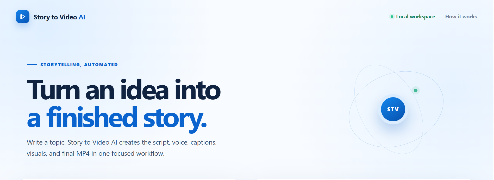

<div align="center">

# 🎬 Story to Video AI — Universal Video Generator

A Python 3.13 portfolio application that turns an English idea into a narrated, captioned MP4 through a reusable AI media pipeline, with both a CLI and a premium local browser studio.


</div>

---

## 📌 Project Overview

**Story to Video AI** converts an English topic about any country, region, subject, or worldwide story into a short video. The original Python pipeline remains the source of truth: it generates a script, creates narration, produces timed captions, finds visual media, and renders an MP4.

The project offers two entry points:

- A command-line interface in `app.py` for direct generation.
- A localhost-only browser studio served by `web_server.py`, a thin HTTP adapter around the existing pipeline.

The adapter adds job admission, status polling, safe media delivery, bounded local execution, and a responsive blue-and-white UI without replacing or redesigning the backend pipeline.

## ✨ Features

### 🖥️ Local Browser Studio

- ✍️ Topic composer with examples and character guidance
- 🔄 Job status polling with queue, script, voice, and render stages
- ▶️ In-browser MP4 preview and download
- 📱 Responsive premium blue-and-white interface
- 🧑‍💻 Developer attribution for Muhammad Ali Nawaz · 2026

### 🧠 AI Video Pipeline

- 🌍 Universal topic support for worldwide stories
- 🤖 LLM provider selection using OpenAI, Groq, or Google Gemini
- 📝 Structured short-form script generation and validation
- 🎙️ Text-to-speech using EdgeTTS or ElevenLabs
- 🗣️ Speech-to-text using local Whisper or Deepgram
- ⏱️ Timed caption generation from speech segments
- 🔎 LLM-generated visual search queries for caption intervals
- 🎬 MoviePy composition with FFmpeg and ImageMagick

### 🛡️ Reliability and Security

- 🔒 English-only input and generated script validation
- 🏠 Localhost-only HTTP adapter with no hosted authentication surface
- 🚦 One worker and a bounded pending-job queue
- 📦 Request body size limit and strict JSON validation
- 🧭 Per-job output names generated with UUIDs
- 🛡️ HTTPS-only, allowlisted Pexels video downloads with timeout, redirect, and size limits
- 🧹 Temporary intermediate audio files and ignored generated outputs
- 🧰 API-free tests and project-only syntax checks

---

## 🖼️ Screenshots

| Homepage |
| --- |
|  |

---

## 🧰 Tech Stack

### Frontend

- Semantic HTML
- Custom responsive CSS
- Vanilla JavaScript using `fetch`, polling, and native video playback

### Backend and Pipeline

- Python 3.13+
- Python standard-library `http.server` adapter
- `argparse` CLI
- `python-dotenv`
- MoviePy and Requests

### AI and Speech

- OpenAI, Groq, or Google Gemini
- Whisper or Deepgram speech-to-text
- EdgeTTS or ElevenLabs text-to-speech

### Media

- Pexels REST API
- FFmpeg and FFprobe
- ImageMagick

### Quality Assurance

- Python `unittest`
- API-free pipeline smoke tests
- HTTP adapter validation tests
- Project-only `compileall`
- GitHub Actions CI
- `pip check`

## 📁 Folder Structure

```text
story-to-video-ai/
├── .github/workflows/tests.yml
├── frontend/
│   ├── index.html
│   ├── styles.css
│   └── app.js
├── utility/
│   ├── audio/
│   ├── captions/
│   ├── render/
│   ├── script/
│   ├── stt/
│   ├── tts/
│   ├── video/
│   ├── config.py
│   ├── content_policy.py
│   └── utils.py
├── tests/
│   ├── test_content_policy.py
│   ├── test_pipeline_smoke.py
│   ├── test_render_engine.py
│   └── test_web_server.py
├── .env.example
├── app.py
├── web_server.py
├── INSTALL_WINDOWS.md
├── requirements.txt
├── LICENSE
└── README.md
```

Generated videos are written to `outputs/`, which is ignored by Git.

## 🔐 Environment Variables

Never commit a real `.env` file. Copy `.env.example` to `.env` in the project root.

```env
LLM_PROVIDER=openai
OPENAI_MODEL=gpt-4o
OPENAI_API_KEY=your_openai_api_key_here

# Required for Pexels visual media:
PEXELS_API_KEY=your_pexels_api_key_here

# Supported values: whisper or deepgram
STT_PROVIDER=whisper
DEEPGRAM_API_KEY=your_deepgram_api_key_here

# Supported values: edgetts or elevenlabs
TTS_PROVIDER=edgetts
EDGETTS_VOICE=en-AU-WilliamNeural
ELEVENLABS_API_KEY=your_elevenlabs_api_key_here
ELEVENLABS_VOICE_ID=your_elevenlabs_voice_id_here

VIDEO_ORIENTATION=portrait
CAPTIONS_ENABLED=true
```

Provider-specific settings and caption styling options are documented in `.env.example`.

## 🚀 Getting Started on Windows

### Prerequisites

- Windows 10 or 11
- CPython 3.13.15 or a later Python 3.13 release
- FFmpeg installed and added to system PATH
- ImageMagick installed and available as `magick` on PATH
- API keys for the selected LLM provider and Pexels

### 1. Create a Virtual Environment

```powershell
py -3.13 -m venv venv
.\venv\Scripts\Activate.ps1
python -m pip install --upgrade pip
```

### 2. Install Dependencies

```powershell
python -m pip install --upgrade -r requirements.txt
```

### 3. Create the Environment File

```powershell
Copy-Item .env.example .env
```

Edit `.env` and add the required LLM and Pexels API keys.

### 4. Start the Browser Studio

```powershell
python web_server.py
```

Open `http://127.0.0.1:8000`, enter an English topic, and select **Generate video**. The browser submits the topic to the local adapter, which runs the existing pipeline in a bounded background worker. Generation requires configured providers and media tools.

### 5. Generate from the CLI

```powershell
python app.py "The history of India's space program"
python app.py "The Eiffel Tower and modern Paris" --output outputs\paris.mp4
```

## 🧪 Test the Project

The automated checks do not require live provider calls, public downloads, or a real video render.

Run each command separately:

```powershell
python -m pip check
python -m compileall -q app.py web_server.py utility tests
python -m unittest discover -s tests -v
python web_server.py --help
```

The complete suite covers universal English topic policy, pipeline orchestration without external APIs, secure media URL handling, HTTP payload validation, output-path privacy, and ImageMagick discovery. A real generation additionally requires API keys, network access to providers/Pexels, FFmpeg, and ImageMagick.

## 📜 Available Commands

| Command | Description |
| --- | --- |
| `python web_server.py` | Start the localhost browser studio |
| `python app.py "A worldwide story"` | Generate a video through the CLI |
| `python app.py "A story" --output outputs\story.mp4` | Choose a CLI output path |
| `python -m unittest discover -s tests -v` | Run the complete Python test suite |
| `python -m compileall -q app.py web_server.py utility tests` | Compile project files without scanning `venv` |
| `python -m pip check` | Verify installed dependency compatibility |
| `python web_server.py --help` | Display browser adapter options |

## 🔌 Local HTTP Endpoints

| Method | Endpoint | Purpose |
| --- | --- | --- |
| `GET` | `/api/health` | Confirm the local adapter is running |
| `POST` | `/api/jobs` | Validate a topic and queue one generation job |
| `GET` | `/api/jobs/{job_id}` | Poll owned local job status |
| `GET` | `/api/media/{job_id}` | Stream a completed MP4 |

The adapter binds to `127.0.0.1` by default. It is intentionally a local development interface, not a hosted multi-user API. There is no database, account system, or global job-list endpoint.

## 🎯 Project Flow

```text
English topic
└── Browser studio or app.py
    └── Existing Python video pipeline
        ├── LLM script generation
        ├── Text-to-speech narration
        ├── Speech-to-text captions
        ├── Pexels visual search and download
        └── MoviePy / FFmpeg MP4 render
```

## 🧑‍💻 Author

**Muhammad Ali Nawaz**  
AI Developer

---

## 📄 License

This project is licensed under the [MIT License](LICENSE).

---

<p align="center">
  <b>⭐ If this project helps you, consider starring the repository!</b>
</p>
